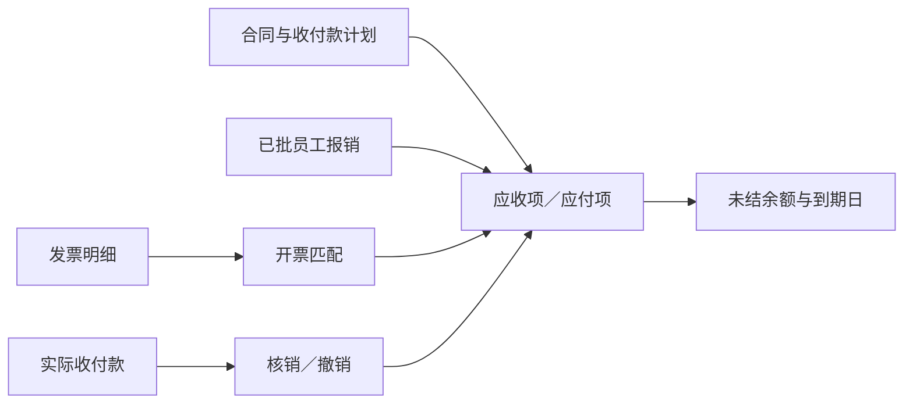

# 企业领域模型第一版设计

本设计定义法人、公司、员工、部门和业务事实的边界，作为逻辑 schema 的依据。各类对象独立建模，合同、项目、工时、费用、发票、付款及会计记录直接关联所需的具体对象。

## 设计范围

第一版覆盖基础对象及其登记、银行账户、任职和组织信息，供应商准入与合作管理，项目预算与合同品项，分阶段交付验收，员工工时、费用与报销，以及开票计划、收付款计划、应收应付、资金结算和账务追溯。本文不限定数据库产品，也不定义具体会计政策和税务处理规则。

## 基础对象与关联方式

### 关键业务信息使用专用字段

用于业务识别、查询、关联、计算、审批和核算的信息，必须明确建模为专用字段；重复项使用字段明确的所属明细。证照、税号、交易角色、金额、账号、日期及业务状态都有固定含义。

不使用“标识类型＋标识值”“属性名＋属性值”、通用对象关联、JSON 扩展包或备注存放关键事实。新增关键业务概念时增加明确字段或专属明细，并说明来源、可空性及应用层规则；尚未确定的设计列为待定。

公司类型等业务分类、主键和审计字段保留明确的统一命名。分类字段表达具体业务分类，不能用来随意切换其他字段的含义。备注和描述仅用于补充说明。

### 每类对象有自己的身份

不建立统一业务参与方身份表，也不建立公司、法人、员工共用的主体 profile。法人、公司、自然人、员工、部门各自拥有主键及专属属性。公司和分公司统一使用 `company` 对象，由 `company_type` 区分；每家公司、分公司仍分别拥有自己的记录和 ID。

法人记录法律信息，公司对象记录公司或分公司的管理及经营信息。`company_type = company` 时填写 `legal_person_id`，与法人对象的一对一关系由应用层维护；`company_type = branch` 时法人 ID 留空，通过 `head_company_id` 关联总公司。子公司仍为 `company` 类型，关联自己的法人，母子公司的股权关系由股东明细表达。[《中华人民共和国公司法》](https://www.samr.gov.cn/xyjgs/flfg/art/2024/art_d4e84936a8a744f8928ac7aec7594345.html)

公司与分公司的核心字段为 `id`、`name`、`company_type`、`legal_person_id`、`head_company_id` 和 `status`。`head_company_id` 只表达分公司隶属，目标为公司类型；普通公司及子公司的该字段留空。两个关联字段在数据库中都可空，条件必填及类型匹配由应用层判断。

公司与分公司直接保存当前统一社会信用代码、营业执照注册号、纳税人识别号、登记名称、注册地址及营业执照材料 ID，并拥有 `company_registration` 登记版本保存历史及来源。应用层在同一事务内维护登记版本与公司当前字段，历史以登记版本为准。公司关联的法人通过公司记录读取同一份登记资料；非公司法人使用自己的法人登记明细。名称及归属变更保存公司版本，历史业务使用发生时的信息。

公司基础资料还包括联系电话、邮箱、办公地址、注册资本及币种、营业期限和分公司负责人；公司银行账户保留户名、账号、开户行、用途及有效期间。实际收付款另存当时账户快照。

自然人记录个人信息，员工是通过 `person_id` 关联自然人的独立人事对象。法定代表人、自然人股东可以不是员工。部门属于内部组织，通过一个 `company_id` 直接归属公司或分公司，并记录行政父部门，不具有独立交易身份。员工雇佣记录明确实际入离职日期、约定合同期限及离职原因；部门明确负责人、联系方式和历史版本。

### 营业执照号码与税号明确命名

| 公司字段 | 业务含义 |
|---|---|
| `unified_social_credit_code` | 统一社会信用代码，现行中国营业执照上的主要登记标识 |
| `business_license_registration_number` | 营业执照注册号／工商注册号，主要保留历史注册号；不适用时可空 |
| `taxpayer_identification_number` | 纳税人识别号，即税号 |
| `business_license_document_id` | 营业执照电子件／扫描件的材料 ID |

对于中国已取得统一社会信用代码的法人和其他组织，税号使用该 18 位代码；信用代码与税号的业务含义分别命名，但其值可以相同。[国家税务总局代码标准公告](https://www.chinatax.gov.cn/chinatax/n810341/n810765/n1465977/n1466017/c1967505/content.html)

号码均作为字符串保存，未知或不适用时允许为空，具体业务的资料完整性由应用层判断。公司与分公司分别填写自己的资料，分公司不默认继承总公司税号。历史旧号保存在登记版本中，已开具发票保存实际票面的开票方及受票方名称、税号快照，主数据变化不改写历史票据。

### 业务对象直接记录具体关联

合同直接记录买方和卖方；项目直接记录客户、管理公司、负责部门和项目负责人；发票直接记录开票方和受票方；付款直接记录付款方、收款方及被代付对象。采购合同、费用和供应商应付直接记录 `supplier_id`，关联独立供应商档案；实际签约、开票和收付款角色仍由业务字段分别表达。

### 供应商是独立的采购管理对象

`supplier` 保存供应商编号、显示名称、所属采购公司、采购负责人、准入审核、合作状态和默认结算条件，并拥有联系人、供货类别、资质及版本明细。它通过明确的 `company_id`、`legal_person_id` 或 `person_id` 关联实际供货对象，确认时恰好填写一个；没有统一 Party 或通用角色关联表。

一条供应商档案表示一个采购公司对一个实际供货对象的管理。同一供货公司可以在 A、B 两家采购公司下有不同供应商编号、准入结论和账期，共用同一公司基础资料。供应商显示名称用于采购管理，营业执照号、税号和登记名称继续由基础对象维护；合同和票据保留实际名称、税号快照。

采购合同直接保存 `procurement_company_id` 与 `supplier_id`，并核对买方公司、卖方对象与档案一致；费用可关联档案，仍独立记录实际供货对象和成本承担对象。供应商应付关联档案并核对债务公司与债权人，员工报销应付则关联员工自然人，原始商户从费用查询。第三方开票或收款根据实际事实及依据分别记录。

默认结算条件用于合同拟订，签订后的到期日以合同计划为准。停用供应商控制新增采购承诺，存量交付、欠款和结算继续按依据处理。准入、合作及默认条件变更保留历史版本，已引用档案不允许更换采购公司或实际供货对象。

某个角色可能是公司、分公司、其他法人或自然人时，业务表保存一组可空的普通 ID 字段，由应用层校验必填角色恰好选一个、可选角色最多选一个。公司和分公司共用该角色的公司 ID 字段，如 `buyer_company_id`、`issuer_company_id`、`payer_company_id`；其他法人、自然人分别使用对应字段。员工经办与公司身份分别记录，部门不作为独立资金收付方。分公司参与业务时直接记录分公司自身 ID，不能自动替换成总公司 ID。

这种设计使关联目标及角色明确。新增对象类型时显式扩展业务字段及应用层处理逻辑。

### 数据库只使用基本约束

所有关联均保存为普通 ID 字段。数据库使用主键、基本字段类型、`NOT NULL`、简单常量默认值和必要的普通索引；不使用外键、触发器、`CHECK`、排他约束、自定义约束函数或业务唯一约束，也不以存储过程执行业务校验。

字段的单选、条件必填、业务唯一性、关联有效性、有效期间和金额规则统一由应用层处理。角色 ID 字段组内的各字段都允许为空，由应用层检查填写组合。下文规则描述业务要求，不表示数据库会自动保证这些要求。

### 多项关系归属对应对象

对象可以拥有类型明确的明细集合：公司对象拥有登记和版本明细，其中公司类型还拥有股东明细；员工拥有雇佣、部门任职和汇报明细，部门拥有服务公司范围，项目拥有交付公司和合同明细，付款拥有核销分配明细。

关系数据库实现时，这些集合可保存为带所属对象关联 ID 的子表；仍由所属对象维护，不设通用关系中心。有效期间、依据和历史版本保留在所属对象及其明细中。持股、分公司隶属、部门层级、用工和汇报各自表达，不能用一个父级字段混在一起。

## 业务事实的边界

项目是管理和成本归集对象，记录范围、负责人、成员、计划及实际日期，并拥有已批准的预算版本。预算使用明确的人工／非人工金额、工时和币种，实际成本不能自动替代预算。

合同记录交易约定及签约快照，品项明确名称、数量、单位、计价方式、不含税价、税额和含税价。阶段条款版本明确交付项、数量及验收条件，实际交付和验收分别保存逐项数量。合同总价、阶段价款、开票计划和收付款计划各有字段。

开票计划表达何时、按什么条件开多少票；收付款计划表达哪一期款、何种用途、何时到期及计划支付金额。条件满足并确认收付义务后建立应收项或应付项，记录债权人、债务人、到期日及实际依据。发票与资金分别关联同一结算项，不重复生成债权债务。

人工投入先记录员工工时及工作内容、可计费标记和审批，再按明确的成本率版本或工资来源形成成本事实。原始含税支出、税额、按政策归集的成本和员工垫付金额分别保存；费用记录供应商及发票依据，分配明细负责归集到项目或阶段。

员工报销引用已有费用，申请及批准金额分别记录；批准后形成员工对应自然人的应付项，实际付款核销该应付项。费用、报销和付款不能被重复累计为三笔成本。

发票保留票面名称、税号、税率及金额，红字更正保留原票关联。付款保留实际收付方、代收代付对象、账号快照、流水号及退款关联。核销到应收／应付；已结算和未结余额由有效核销及调整计算。

会计记录明确账簿、科目、期间、凭证日期、审核和过账人员，并通过分录来源明细关联具体业务。收入确认单独记录政策版本、确认金额及依据。验收、开票、到账、收入确认和过账各有自己的事实与状态。

## 核心对象

| 对象 | 保存内容 | 直接关联／拥有的明细 |
|---|---|---|
| 法人 | 法律名称、法人类型、存续状态 | 非公司法人登记、法定代表人任期 |
| 公司（含分公司） | 类型、信用代码、营业执照注册号、税号、登记及联系资料 | 法人或总公司 ID、登记版本、银行账户、适用的股东明细 |
| 自然人及员工 | 姓名、联系资料、员工编号及档案状态 | 自然人 ID、用工合同及实际任职期间、部门任职、汇报明细 |
| 部门 | 名称、层级、负责人及联系资料 | 所属公司或分公司、服务范围及版本 |
| 供应商 | 采购公司、供应商编号、准入、合作状态、负责人及默认结算条件 | 具体公司／法人／自然人、联系人、供货类别、资质及版本；采购合同、费用、应付直接引用 |
| 项目及预算 | 项目范围、负责人、计划及实际时间、预算口径 | 交付公司、合同、成员、预算版本及审批 |
| 合同及品项 | 买卖方、签署人、联系人、签约快照、计价及含税／不含税价款 | 合同版本、品项版本、补充协议 |
| 阶段及交付项 | 阶段负责人、交付内容、数量、单位、验收条件和日期 | 合同阶段条款版本及交付项明细 |
| 开票计划 | 开票条件、计划日期及含税开票金额 | 合同条款版本、可选阶段、替代计划 |
| 收付款计划 | 款项期次、用途、付款条件、到期规则和计划金额 | 合同条款版本及可选阶段 |
| 工时及成本率 | 工作内容、小时数、是否计费、审批及适用成本率 | 员工、雇佣、项目、阶段、成本率版本 |
| 成本事实及分配 | 供应商、实际支出、成本口径、员工垫付、归集金额 | 工时／工资来源、发票匹配、项目／阶段分配 |
| 员工报销 | 报销人、承担报销义务的公司、申请及批准金额 | 已有费用明细、审批及应付项 |
| 交付及验收 | 提交数量、交付物版本、签署人、通过及不通过数量 | 阶段交付项、重提／更正记录及材料 |
| 发票 | 票种、代码、号码、实际名称／税号快照及税额 | 发票行、原票、合同／项目／结算项分配 |
| 应收项／应付项 | 债权债务对象、本金、币种、到期日和确认依据 | 合同款项、报销等实际业务、增减调整 |
| 收付款及核销 | 实际收付方、代收代付、账户、流水、本金及退款 | 应收／应付项核销、原付款、原核销 |
| 账簿、科目、期间 | 归属法人、币种、记账科目及开放期间 | 公司范围、科目层级及期间启闭记录 |
| 凭证及分录来源 | 凭证日期、摘要、借贷、审核及过账记录 | 会计科目、项目维度及明确类型的业务来源明细 |
| 收入确认 | 本次确认金额、期间、政策版本及审批依据 | 合同版本、项目／阶段、可选验收、冲回记录及分录 |

## 三阶段项目检查

以下数字仅用于核对模型结构。合同含税总价 30 万元，阶段价款为 6 万、12 万、12 万；税额未知时留空。员工在不同阶段投入工时，发生差旅和云服务费用。阶段一已验收、开票 6 万元、收到 3 万元；阶段二已提交未验收；阶段三未开始。

| 需要回答的问题 | 对应记录及计算 |
|---|---|
| 谁签约、谁交付、谁承担成本 | 合同买卖方、项目交付公司、成本承担对象分别记录 |
| 计划投入与实际成本差多少 | 批准的项目预算版本与相同币种、相同人工口径的实际分配比较 |
| 员工 8 小时如何形成成本 | 已批工时 × 适用每小时成本 200 元，保存来源和快照，得到成本事实 1,600 元 |
| 10 项交付分两次验收如何计算 | 首次通过 7、未通过 3，剩余 3 项复验通过，累计通过 10；不重复计算首次已通过部分 |
| 开票和资金安排是否一致 | 独立查询开票计划及收付款计划，允许时间和金额分布不同 |
| 阶段一还应收多少 | 确认应收 60,000，付款核销 30,000，未结为 30,000；开票匹配不再增加应收 |
| 无发票时能否记录收付款 | 可以确认有依据的结算项并核销，或暂存未分配付款；后补发票关联原项 |
| 已确认多少收入 | 从独立收入确认事实查询政策依据和金额，再从分录来源确认哪些已过账 |

## 本次复核设计决定（2026-10-11）

| 原模型缺口 | 采用的设计 | 取舍及影响 |
|---|---|---|
| 只有供货对象 ID，缺少供应商管理档案 | 增加按采购公司管理的 `supplier`，业务记录直接保存供应商 ID | 增加专门的档案及版本，能管理准入与合作；应用层核对档案和实际供货对象一致，基础登记资料不重复维护 |
| 开票与请款共用一个金额和触发描述 | 分别建立开票计划和收付款计划，明确金额、日期及条件字段 | 多一类计划对象，能表达先款后票及不同付款节奏；复杂条件保留人工确认 |
| 付款只能关联发票 | 应收项／应付项独立建模，付款核销结算项，发票另作匹配 | 增加结算及调整明细，避免无票报销和预付款没有落点，也避免开票重复记债 |
| 交付、部分验收只有头部状态 | 增加阶段交付项、提交明细及验收数量明细 | 明细增多，但能核对分批交付、复验及换版后累计数量 |
| 凭证只能追到材料 | 增加分录业务来源及收入确认事实 | 可追到业务金额和政策版本；自动计算政策仍需业务定义 |

执行上保留普通 ID 关联和应用层校验。资料变更、资金核销及过账更正需要事务和并发控制，避免重复确认、重复核销或并发超分配。银行账号、员工联系方式和工资成本等资料的访问权限在实现阶段按岗位控制。

## 边界场景

### 同一供货公司对应多个采购公司

供货公司 S 共用一份公司基础资料；A、B 各自维护 S 的供应商档案，默认账期可以分别为 30 天和 60 天。A 暂停合作不改变 B 的合作状态，也不抹去 A 的未结应付。A、B 的采购合同及供应商应付分别引用各自档案，实际开票和收款方按单据记录。

### 合同变更

补充协议改变阶段金额、时间、交付内容或验收条件时，保留原条款、变更依据、签署和生效时间，以及新条款版本。交付记录引用实际适用的版本；原有交付、验收和财务单据不被覆盖。签约对象变更同样保留合同版本。

### 费用跨项目分配

一笔 1 万元云服务费记录一个成本事实，其分配明细记录项目 A 6,000 元、项目 B 4,000 元。原始费用、承担对象、分配方法及未分配金额均可追溯。付款行为独立保存。

### A 签约、B 交付

合同卖方直接引用 A 公司，项目交付公司明细引用 B 子公司。B 不因交付成为客户合同的签约方。A、B 如有内部服务合同和结算，另行记录其交易、单据和双方账务。项目管理归集不自动把 B 的支出记入 A 的法定账簿。

### 分公司独立记录业务

A 公司与 A 上海分公司分别建立 `company` 记录，分公司的 `company_type = branch`、`head_company_id = A.id`，自身 `legal_person_id` 留空。其登记明细关联上海分公司自己的 ID。

由上海分公司实际参与的合同、开票、收付款和用工，各自的公司 ID 字段均记录上海分公司；所属部门的 `company_id` 也记录该 ID。分公司账簿的 `scope_company_id` 保存分公司 ID，归属法人沿总公司查找。业务身份、部门归属与账簿范围都不会因合并对象而丢失。

### C 代客户付款

合同买方和发票受票方仍引用客户；付款方引用 C，被代付对象引用客户。付款核销关联客户对应的应收项，代付依据解释实际付款人与债务人的差异，不修改交易角色。

### 员工报销与退款

员工垫付 500 元费用，报销申请及批准金额各自保存。批准 500 元后形成员工应付项，支付并核销 500 元；原成本只记录一次。

客户应收 60,000 元已结算 30,000 元，实际退款 10,000 元时，新建反向付款并撤销原核销的相应部分，净已结算为 20,000 元。若退款还伴随价款减免，另外记录应收减少调整，不能单凭退款推断合同被取消。

## 应用层数据一致性规则

以下规则在应用业务流程中处理，不生成数据库约束。并发写入时需结合事务及并发控制维护一致性；当前文档只定义要求，尚未实现应用代码。

- 关键事实使用专用字段；付款账号与收款账号、银行流水号与平台流水号分别保存，验收结果与补充意见分别记录。
- 公司类型填写法人 ID 并维护一对一关系；分公司类型填写总公司 ID，法人 ID 留空。总公司必须是公司类型，不能指向自身；子公司通过股东明细表达母子关系。
- 具体对象关联 ID 有效，多类型角色按规定只选择一个；部门直接归属公司或分公司记录，账簿范围按有效归属对应法人。
- 公司与分公司的登记记录分别保存，应用层处理登记标识去重，法人对象不重复维护同一公司证照。
- 当前信用代码、营业执照注册号和税号与有效登记版本一致；号码变更保留旧版本，已开具发票的名称及税号快照保持票面原值。
- 员工的雇佣、任职、汇报及工时引用一致，时间落在对应有效期间；历史不被当前部门覆盖。
- 项目、合同、阶段、计划及条款版本相互一致；合同阶段编号在合同内唯一。
- 工时不是金额，人工成本生成及分配保留口径并防止同一投入重复计入。
- 同一费用的项目分配、发票匹配、员工报销及付款分别记录，避免重复计成本。
- 发票按票面金额及符号匹配；付款核销应收／应付项，未结余额等于调整后本金减有效净核销金额，开票匹配不计入核销。
- 同一资金同时对应集团内部双方时，应收侧和应付侧分别核对额度，不能相加为两笔资金流水。
- 部分验收按交付项数量核对；重提、复验及条款换版不重复确认已完成数量。
- 退款保留原付款和原核销关系，错误核销通过明确撤销记录更正；实际退款与纯核销纠错分别处理。
- 会计分录追溯业务凭据，按账簿规则平衡；验收、开票和收款不自动代表收入确认。

## 本次补齐范围

已补齐基础资料与银行账户、独立供应商档案及采购关联、员工及部门责任人、项目成员及预算、合同金额口径与品项、两类计划、工时和费用审批、员工报销、分批验收、发票更正、应收应付及核销、会计科目与期间、分录来源和收入确认记录。供应商对象是在后续讨论中发现遗漏后补正，前次复核未覆盖该管理对象。具体字段、可空说明及场景核对见 [逻辑 Schema](/Users/yangzhenning/fst-domain-model/docs/logical-schema-v1.md)。

逻辑模型后续已落地为梁山集团本地 Demo，包含 Spring Boot 4、JPA、SQLite、Thymeleaf 页面、108 位员工、十个项目及主要业务流程。具体实现边界和操作方式见 [Demo 模型映射](demo-model-mapping.md) 与 [操作场景](demo-scenarios.md)。当前以单币种项目业务为边界，明确字段与示例政策不等于全部核算政策已经自动化。

## 后续待定事项

1. 人工成本率来源、工资与标准成本口径、审批权限及预算规则。
2. 收入确认的进度计量、履约义务分摊和自动计算策略；已具备存放确认结论的字段。
3. 外币记账、跨币种核销、预收／预付抵扣、净额结算、坏账及汇兑处理。
4. 内部交易自动对账与合并抵销，以及多级审批流程。
5. 物理数据库、类型精度、普通索引、应用层事务／并发控制及敏感资料访问权限。

## 参考依据

- [中华人民共和国公司法（国家市场监督管理总局）](https://www.samr.gov.cn/xyjgs/flfg/art/2024/art_d4e84936a8a744f8928ac7aec7594345.html)
- [市场主体登记文书规范（国家市场监督管理总局）](https://www.samr.gov.cn/cms_files/filemanager/samr/www/samrnew/samrgkml/nsjg/djzcj/202203/W020221117604890183594.pdf)
